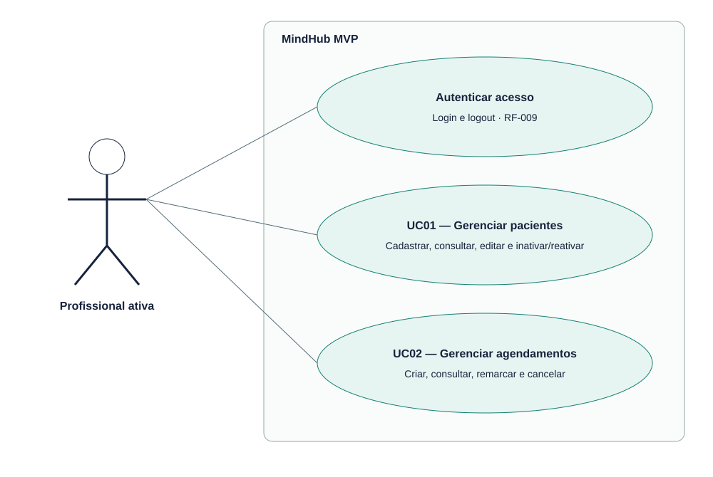

# EST-04-CASOS-USO — Diagrama de caso de uso

Versão 0.1 · AGUARDANDO REVISÃO · 23/10/2026.

Único ator: profissional ativa. Paciente é entidade, sem acesso próprio no MVP.

Fontes editáveis: EST-04-CASOS-USO.mmd (semântica Mermaid), EST-04-CASOS-USO.svg (vetor) e scripts/diagrams.mjs (layout reproduzível). Implementação: src/domain.ts, src/server.ts e migrations/001_initial.sql.
