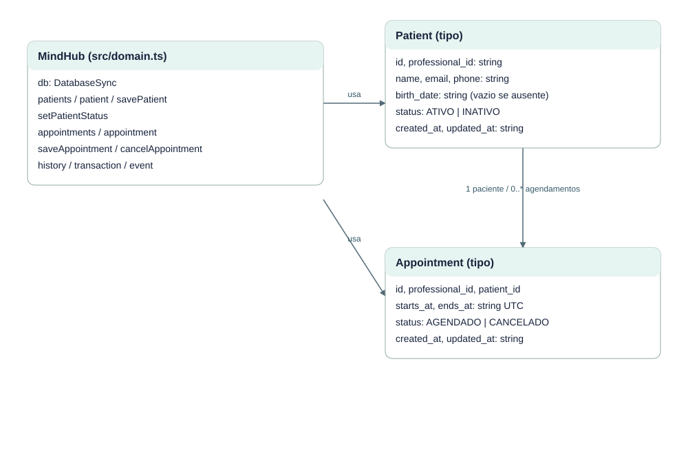

# EST-05-CLASSES — Diagrama de classes e tipos do domínio

Versão 0.1 · AGUARDANDO REVISÃO · 23/10/2026.

Patient e Appointment são tipos TypeScript; MindHub é classe de serviço. Campos de tempo são ISO UTC.

Fontes editáveis: EST-05-CLASSES.mmd (semântica Mermaid), EST-05-CLASSES.svg (vetor) e scripts/diagrams.mjs (layout reproduzível). Implementação: src/domain.ts, src/server.ts e migrations/001_initial.sql.
