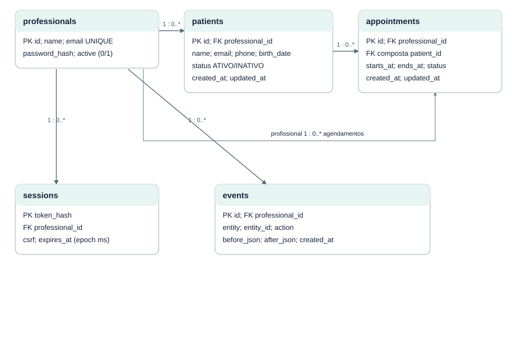

# EST-06-DER — Diagrama entidade-relacionamento

Versão 0.1 · AGUARDANDO REVISÃO · 23/10/2026.

FK composta appointments(professional_id,patient_id) → patients(professional_id,id). E-mail único por carteira. events.entity_id é referência lógica, sem FK polimórfica. schema_migrations é controle técnico.

Fontes editáveis: EST-06-DER.mmd (semântica Mermaid), EST-06-DER.svg (vetor) e scripts/diagrams.mjs (layout reproduzível). Implementação: src/domain.ts, src/server.ts e migrations/001_initial.sql.
