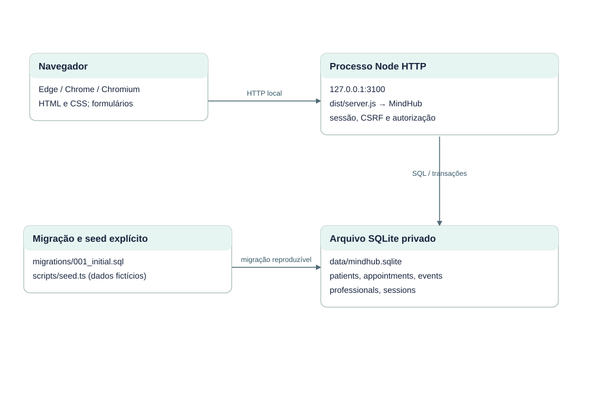

# EST-09-IMPLANTACAO — Implantação local real do MVP

Versão 0.1 · AGUARDANDO REVISÃO · 23/10/2026.

Um computador, um processo Node e arquivo persistente. HTTP em loopback. Sem conexão com produção, Supabase, Netlify ou GitHub durante o uso. Deploy público não executado.

Fontes editáveis: EST-09-IMPLANTACAO.mmd (semântica Mermaid), EST-09-IMPLANTACAO.svg (vetor) e scripts/diagrams.mjs (layout reproduzível). Implementação: src/domain.ts, src/server.ts e migrations/001_initial.sql.
