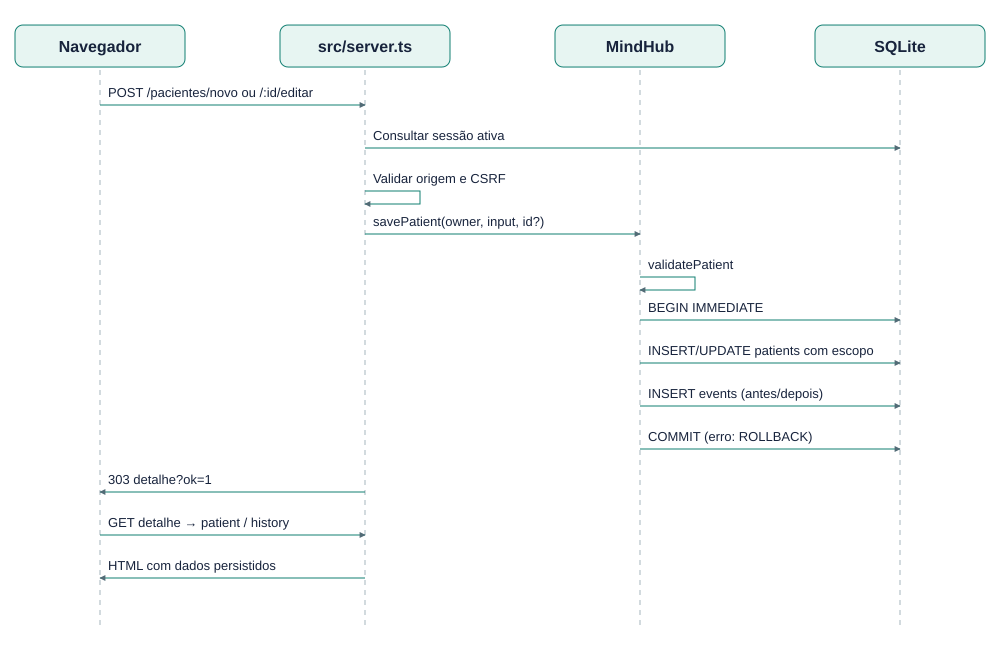

# EST-10-SEQUENCIA-UC01 — Sequência UC01 — cadastrar/editar paciente

Versão 0.1 · AGUARDANDO REVISÃO · 23/10/2026.

Participantes: navegador, servidor, serviço MindHub e SQLite. Inativar/reativar usa setPatientStatus na mesma estrutura transacional.

Fontes editáveis: EST-10-SEQUENCIA-UC01.mmd (semântica Mermaid), EST-10-SEQUENCIA-UC01.svg (vetor) e scripts/diagrams.mjs (layout reproduzível). Implementação: src/domain.ts, src/server.ts e migrations/001_initial.sql.
