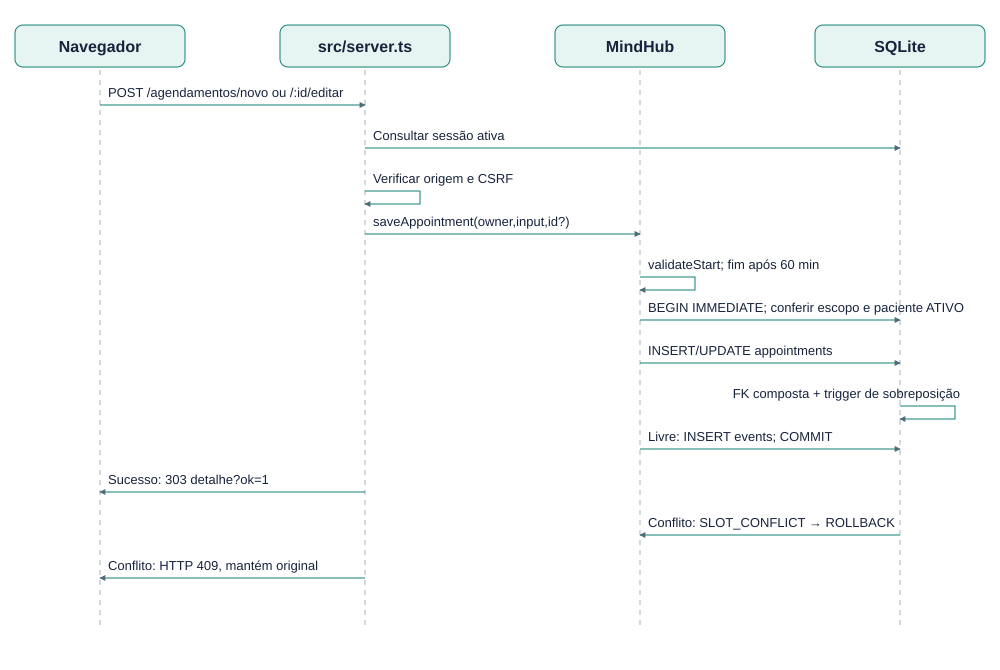

# EST-11-SEQUENCIA-UC02 — Sequência UC02 — criar/remarcar

Versão 0.1 · AGUARDANDO REVISÃO · 23/10/2026.

Caminhos de sucesso e conflito são alternativos. Validação ocorre antes de persistir; trigger impede sobreposição.

Fontes editáveis: EST-11-SEQUENCIA-UC02.mmd (semântica Mermaid), EST-11-SEQUENCIA-UC02.svg (vetor) e scripts/diagrams.mjs (layout reproduzível). Implementação: src/domain.ts, src/server.ts e migrations/001_initial.sql.
