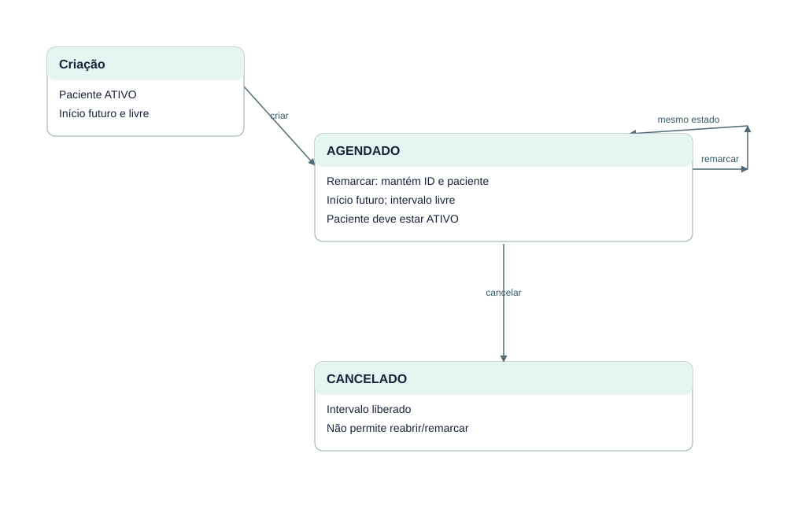

# EST-12-ESTADOS — Estados da entidade Agendamento

Versão 0.1 · AGUARDANDO REVISÃO · 23/10/2026.

AGENDADO não muda automaticamente com a passagem do tempo. Falha de remarcação conserva estado e horário. Cancelamento é terminal; eventos preservam a história.

Fontes editáveis: EST-12-ESTADOS.mmd (semântica Mermaid), EST-12-ESTADOS.svg (vetor) e scripts/diagrams.mjs (layout reproduzível). Implementação: src/domain.ts, src/server.ts e migrations/001_initial.sql.
