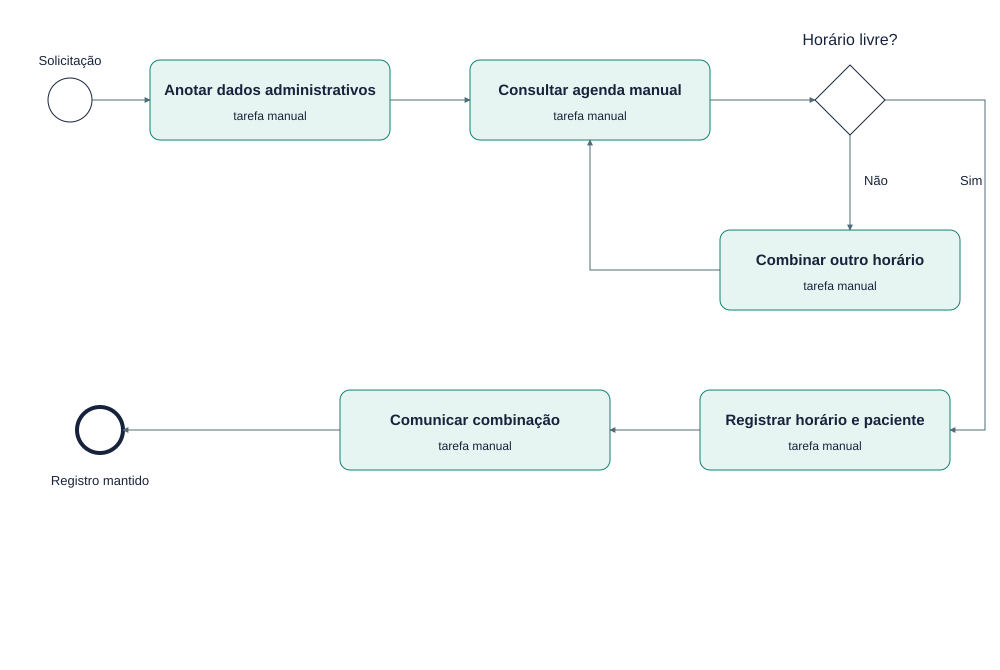

# EST-18-AS-IS — Workflow As-Is — hipótese a validar

Versão 0.1 · EM ELABORAÇÃO · 23/10/2026.

EM ELABORAÇÃO: processo manual anterior hipotético. Não foi observado nem confirmado. Não é fluxo To-Be do software. Nenhum sistema ou banco participa deste desenho.

Fontes editáveis: EST-18-AS-IS.mmd (semântica Mermaid), EST-18-AS-IS.svg (vetor) e scripts/diagrams.mjs (layout reproduzível). Implementação: src/domain.ts, src/server.ts e migrations/001_initial.sql.
