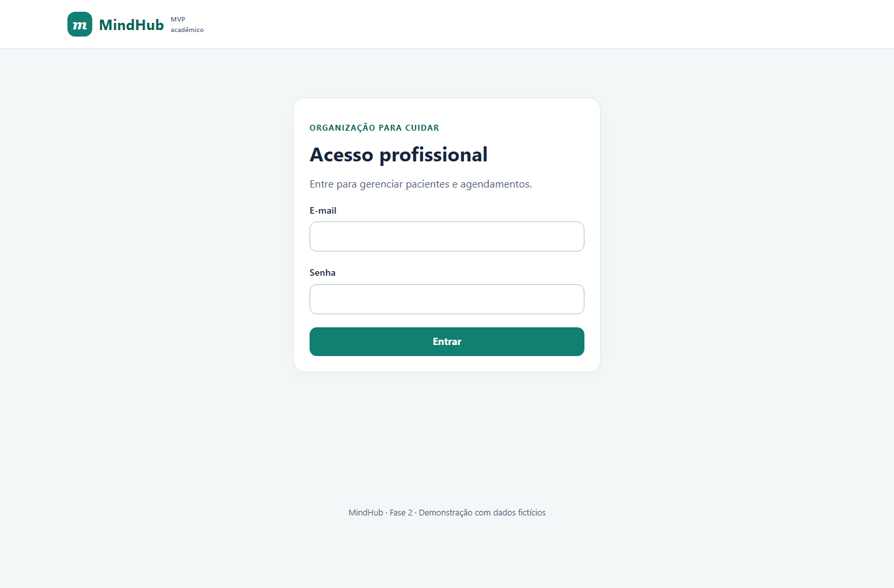
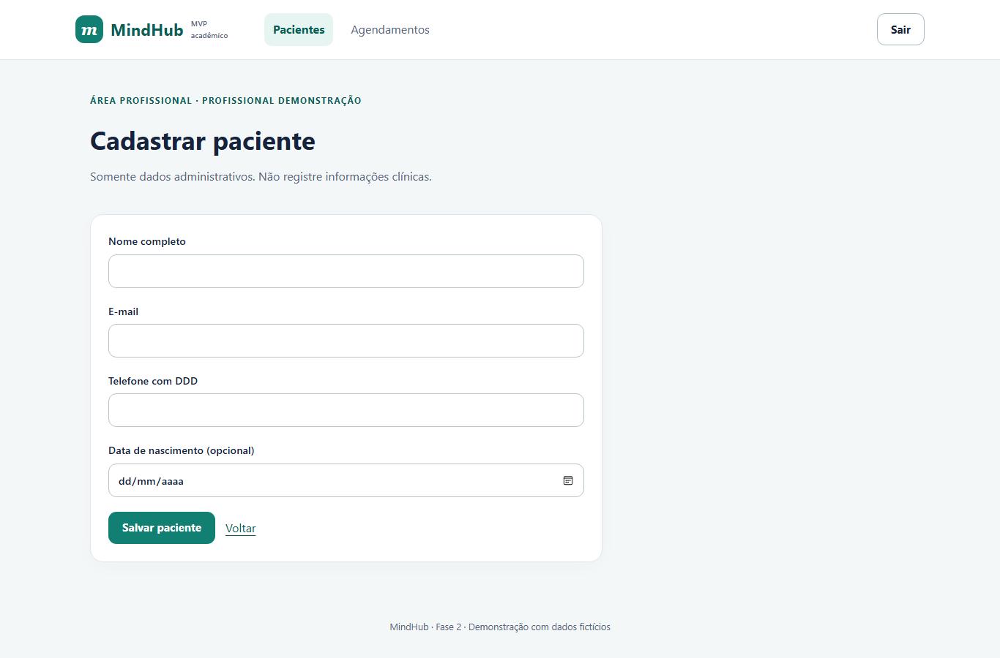
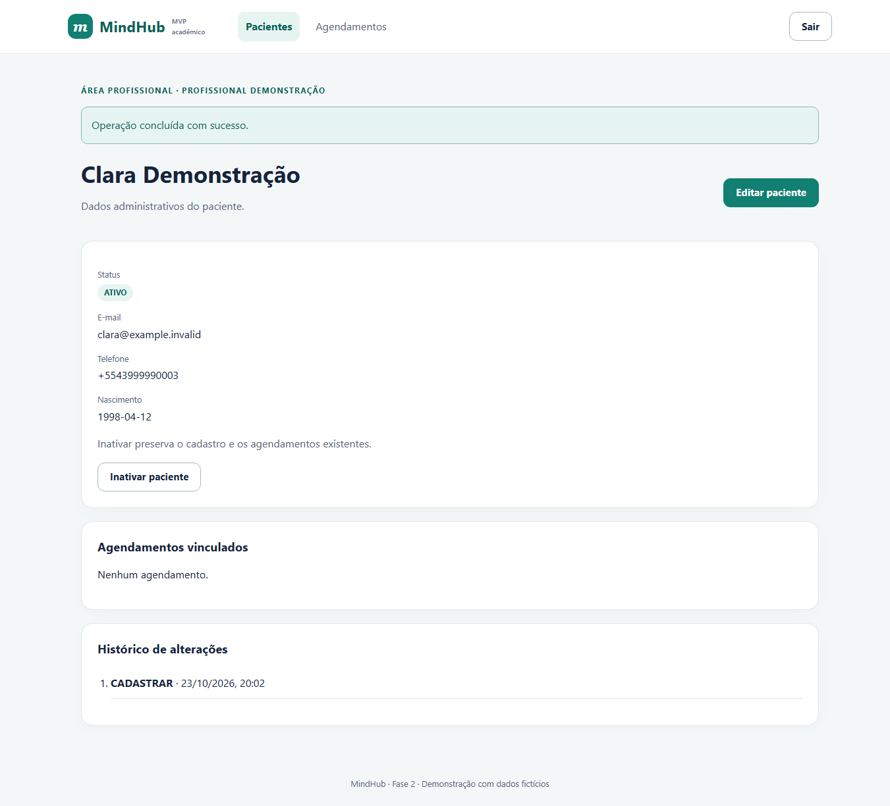
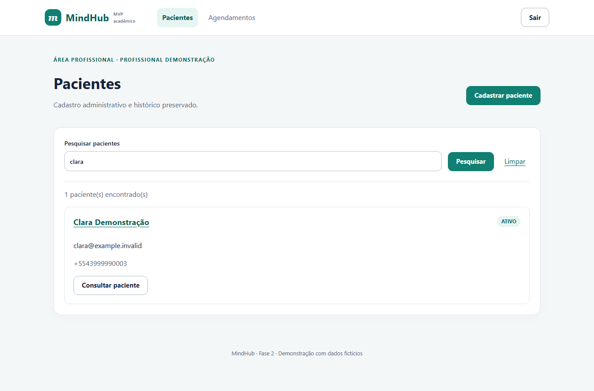
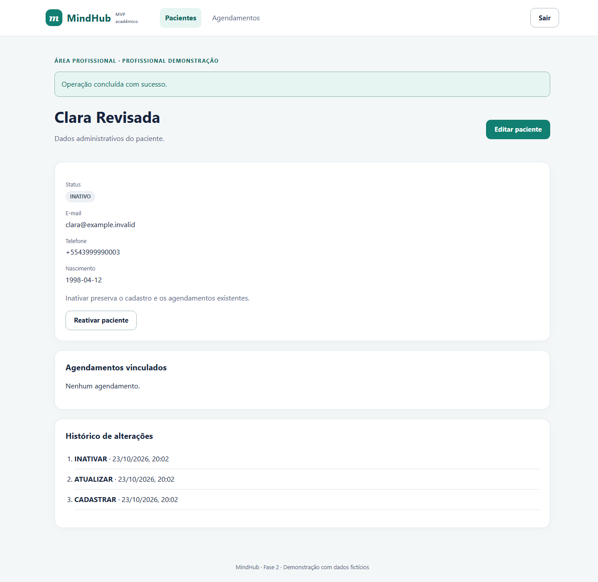
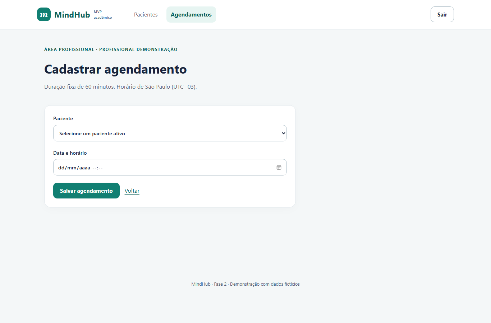
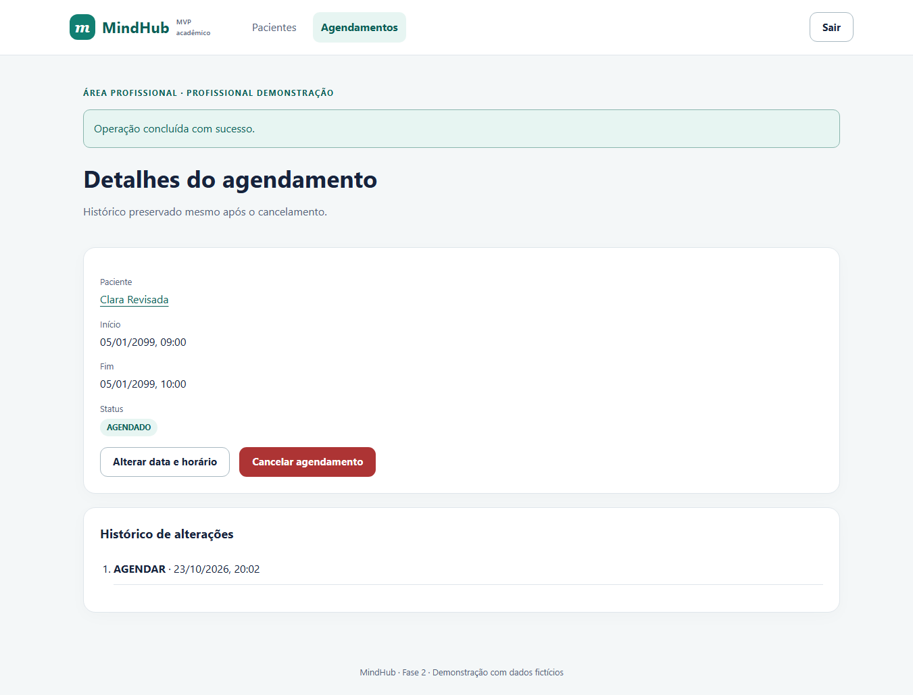
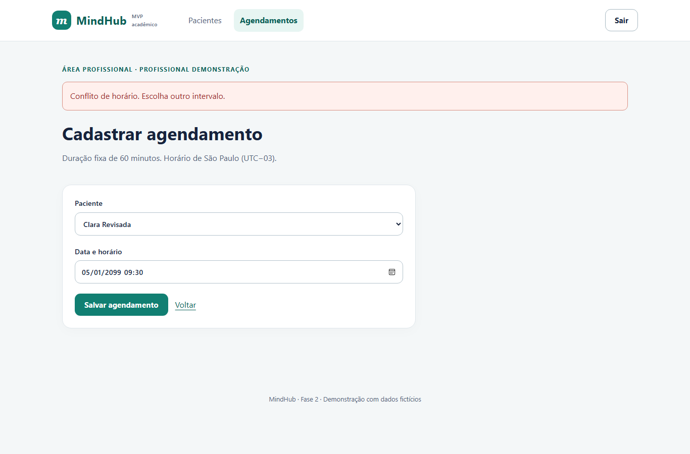
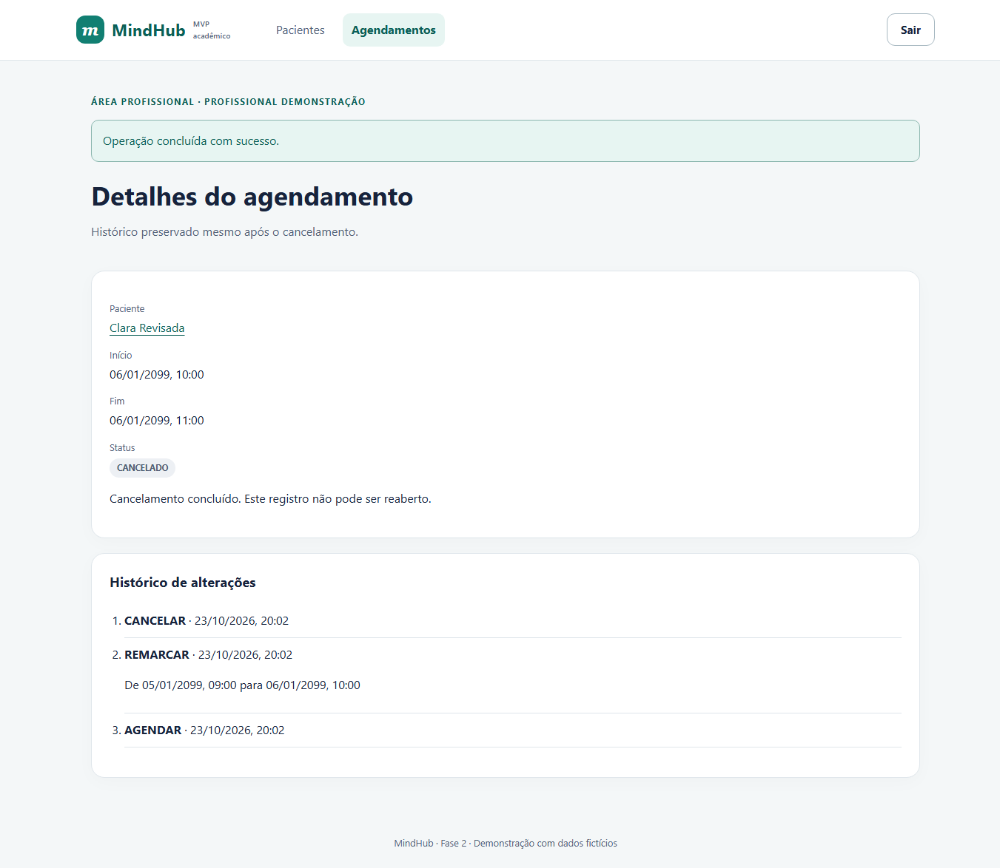

# EST-14 — Interfaces reais do MindHub MVP

Versão 0.1 · AGUARDANDO REVISÃO · 23/10/2026 · código MVP 923f5b0. Capturas reais feitas pelo script e2e/browser.mjs em banco temporário independente, usando apenas Clara Demonstração/Clara Revisada e contatos fictícios. Não são mockups.

## TELA-01 — Acesso profissional

Página protegida redireciona para login; autenticação profissional. RF-009.

## TELA-02 — Cadastro administrativo

Nome, e-mail, telefone e nascimento opcional. RF-001.

## TELA-03 — Detalhe do paciente

Dados persistidos, estado, acesso à edição e histórico. RF-001/002/003.

## TELA-04 — Pesquisa

Pesquisa por nome, e-mail ou telefone. RF-002.

## TELA-05 — Paciente inativo

Inativação preserva cadastro/agenda e oferece reativação. RF-004.

## TELA-06 — Cadastro de agendamento

Paciente ativo, início futuro no horário de São Paulo e duração de 60 minutos. RF-005.

## TELA-07 — Detalhe do agendamento

Consulta com paciente, início, fim e estado. Acesso à alteração e ao cancelamento. RF-006/007/008.

## TELA-08 — Conflito de intervalo

Sobreposição rejeitada no servidor e no banco, com formulário preservado. RNF-003/007.

## TELA-09 — Cancelamento e histórico

Estado terminal, horário preservado e eventos, inclusive remarcação com antes/depois. RF-007/008.

## TELA-10 — Layout móvel em 320 pixels

Detalhe do agendamento em viewport estreito. Outras páginas e larguras foram verificadas automaticamente, conforme navegador.json. RNF-005.
